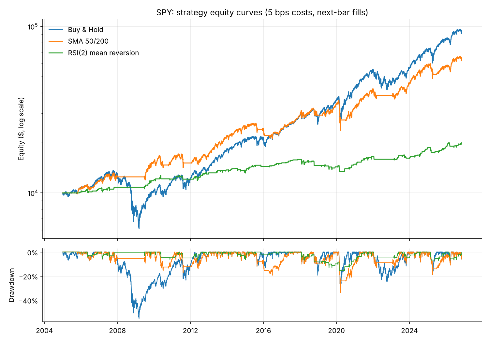

# signal-backtester

A small, readable backtesting engine in Python for testing rule-based trading strategies on daily stock and ETF data.

I built this to understand what a backtester actually does under the hood: turning signals into positions, avoiding look-ahead bias, charging transaction costs, and measuring risk-adjusted performance. It was inspired by the design of [NautilusTrader](https://github.com/nautechsystems/nautilus_trader), a production-grade trading platform. This project is a much smaller, from-scratch take on the same ideas, meant for research and learning.



## Results: SPY, 2005 to 2026

5 bps transaction cost per trade, signals filled on the next day's close.

| Strategy | CAGR | Volatility | Sharpe | Max drawdown | Time in market |
|---|---|---|---|---|---|
| Buy & Hold | 10.8% | 18.9% | 0.64 | -55.2% | 100% |
| SMA 50/200 crossover | 8.9% | 13.6% | 0.70 | -33.7% | 76% |
| RSI(2) mean reversion | 3.2% | 6.0% | 0.56 | -15.6% | 13% |

**Takeaways**
- The 50/200-day trend filter gave up about 2 points of annual return but cut the worst drawdown from -55% to -34% (it sat out most of 2008), so its Sharpe ratio was slightly higher than buy & hold.
- RSI(2) mean reversion was only in the market 13% of the time. Its return per unit of exposure is high, but on its own it leaves most of the market's gains on the table.
- None of these are "alpha". They are risk-shaping rules, and the results depend on the period tested.

## How it works

```
prices ──► Strategy.positions() ──► shift 1 day ──► × daily returns ──► − costs ──► equity curve ──► metrics
```

- **No look-ahead:** a signal computed from day *t*'s close is only held from day *t+1*. This is enforced by the engine, not left to each strategy, and covered by a unit test.
- **Costs:** every change in position pays `cost_bps` on the amount traded.
- **Metrics:** CAGR, annualized volatility, Sharpe, Sortino, max drawdown, time in market and number of trades.

| File | What it does |
|---|---|
| `backtester/engine.py` | Runs a strategy and builds the equity curve |
| `backtester/strategies.py` | Buy & Hold, SMA crossover (optionally long/short), RSI mean reversion with a trend filter |
| `backtester/metrics.py` | Performance and risk statistics |
| `backtester/data.py` | Downloads prices with `yfinance` and caches them as CSV |
| `tests/` | Unit tests for fills, costs and indicators |

## Run it

```bash
pip install -r requirements.txt
python -m backtester SPY --start 2005-01-01 --plot figures/spy_equity.png
python -m backtester QQQ --cost-bps 10
pytest
```

Add your own strategy by subclassing `Strategy` and returning a position (-1 to 1) for each day:

```python
from backtester import Backtest, load_prices
from backtester.strategies import Strategy
import pandas as pd

class Momentum(Strategy):
    name = "12-month momentum"
    def positions(self, prices):
        return (prices.pct_change(252) > 0).astype(float)

result = Backtest(load_prices("SPY")).run(Momentum())
print(result.stats)
```

## Limitations

Daily bars only, one asset at a time, no slippage model beyond a flat cost, and no position sizing. Past performance in a backtest says little about the future.
